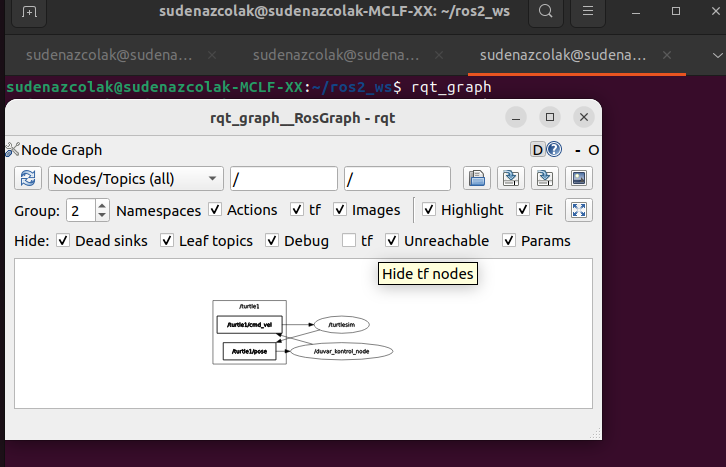
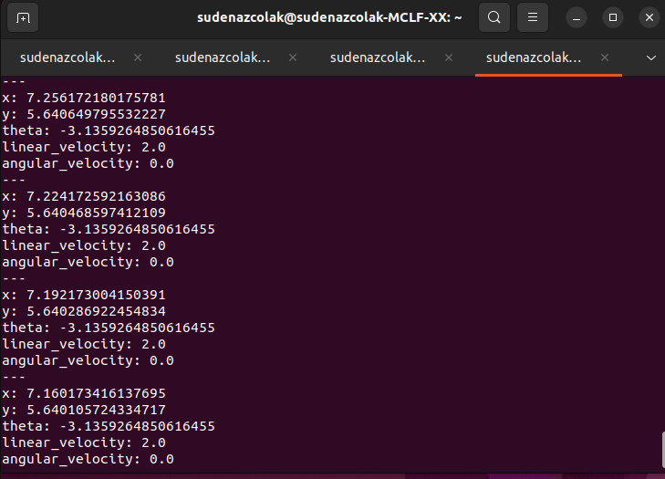
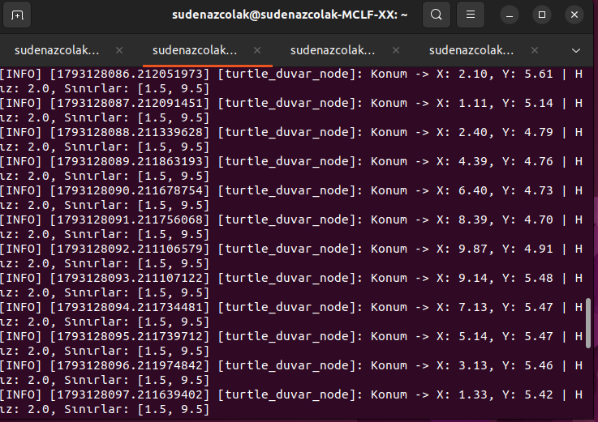
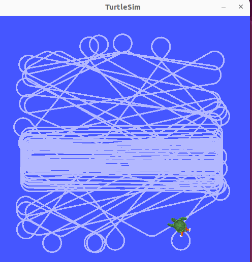
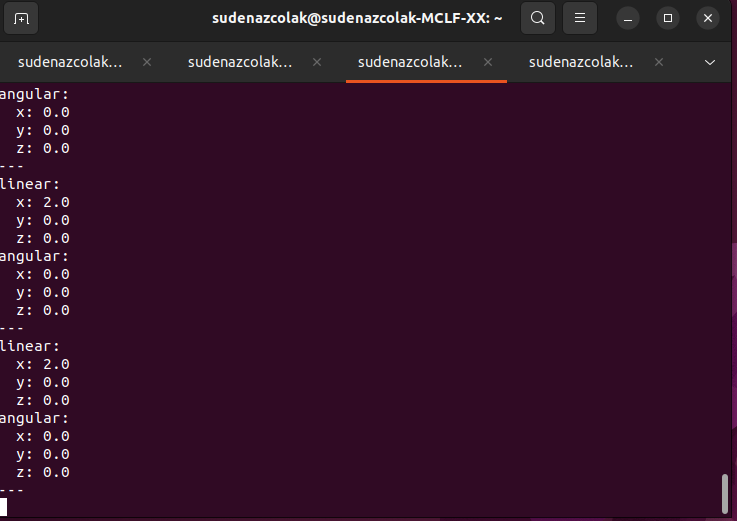

# 🐢 ROS 2 Duvardan Kaçan Kaplumbağa

Bu proje, ROS 2 ortamında `turtlesim` simülasyonunu kullanarak kaplumbağanın duvar sınırlarına çarpmadan hareket etmesini sağlayan kontrol düğümüdür.

---

## 1. Düğüm İlişkileri (Rqt Graph)


---

## 2. Konum Verileri (/turtle1/pose)
Kaplumbağanın anlık konum ve yönelim bilgileri dinlenir:


---

## 3. Duvar Kontrolü ve Terminal Logları
`get_logger().info()` ile yazdırılan anlık konum ve sınır kontrol logları:


---

## 4. Turtlesim Simülasyon Hareketi
Kaplumbağanın sınırlara ulaştığında dönerek alan içinde kalışı:


---

## 5. Hız Komutları (/turtle1/cmd_vel)
Kaplumbağaya iletilen `geometry_msgs/msg/Twist` mesajları:


---

## 🚀 Kurulum ve Çalıştırma

Projeyi kendi ROS 2 çalışma alanınızda çalıştırmak için aşağıdaki adımları izleyebilirsiniz:

```bash
cd ~/ros2_ws
colcon build --packages-select turtle_duvar_py
source install/setup.bash
